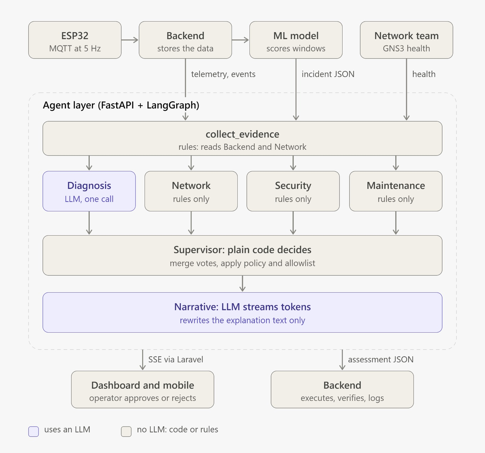

# AegisOT AI

The **AI team's part** of AegisOT, a smart-factory platform (IoT + ML + agentic AI + network security).

An ESP32 sends sensor data. An ML model spots anomalies. When it finds a real one, a small team of **agents** works out *why* it happened, proposes *what to do*, and a **human operator approves or rejects** it. The AI never executes anything on its own.

---
<p align="center">
  
</p>

## How it works

1. **ESP32** sends telemetry at 5 Hz over MQTT. The **Backend** stores it.
2. The **ML model** scores sliding windows of data. If it sees an anomaly, it sends an *incident JSON* to the agent layer.
3. The **agent layer** (FastAPI + LangGraph) does the rest:
   - `collect_evidence` reads telemetry, events and network health (plain code, no LLM).
   - Four specialists vote on the cause: **Diagnosis**, **Network**, **Security**, **Maintenance**.
   - The **Supervisor** merges the votes and applies the safety policy. This is plain code, not an LLM.
   - A **Narrative** step lets an LLM rewrite the explanation text, and nothing else.
4. The result goes to the **Dashboard / mobile app** (operator approves or rejects) and to the **Backend** (executes, verifies, logs).

### Where the LLM is used (and where it is not)

| Step | Uses an LLM? |
|---|---|
| Diagnosis agent | Yes, one call |
| Narrative (explanation text) | Yes, text only |
| Network, Security, Maintenance agents | No, rules only |
| Evidence collection, Supervisor, action policy | No, plain code |

If the LLM is off or fails, the system falls back to rules and still returns a result.

### Safety rules

- Agents only **read** data. They never run commands.
- Actions come from a fixed **allowlist** (for example `stop_equipment`, `isolate_device`, `inspect_equipment`).
- Risky actions always require **operator approval**.
- Low confidence returns *inconclusive* instead of a guess.

---

## Repository structure

```text
AegisOT-AI-team/
├── configs/          config.yaml (non-secret settings)
├── data/             datasets (ML team)
├── models/           trained models (ML team)
├── notebooks/        experiments and analysis
├── src/
│   ├── data/         preprocessing + feature engineering (ML team)
│   ├── ml/           training + prediction (ML team)
│   ├── agents/       the agent layer (LangGraph + crewAI)
│   └── api/          FastAPI app entry point (main.py)
├── tests/            automated tests
├── .env.example      copy to .env and add your keys
├── check_agents.sh   full check of the agent layer (no LLM needed)
├── check_agent_llm.sh  same, plus a real LLM test (--llm)
├── pytest.ini
└── requirements.txt
```

Inside `src/agents/`:

| File | Job |
|---|---|
| `graph.py` | The LangGraph workflow: evidence → 4 specialists → supervisor |
| `roles.py`, `rules.py`, `agents.py` | The specialists: who they are, their rule logic, their LLM version |
| `supervisor.py`, `policy.py` | Merge votes, choose the action, apply the allowlist |
| `tools.py`, `crew_tools.py` | Read-only evidence fetchers |
| `clients/` | Backend and Network connections (mock or real HTTP) |
| `router.py`, `service.py`, `cli.py` | API endpoints, business logic, command-line demo |
| `docs/` | `ARCHITECTURE.md`, `CONTRACTS.md` (JSON for every team), `CHANGES.md` |

---

## Quick start

```bash
git clone https://github.com/AhmedYasser06/AegisOT-AI-team.git
cd AegisOT-AI-team
python -m venv .venv && source .venv/bin/activate      # Windows: .venv\Scripts\activate
pip install -r requirements.txt
cp .env.example .env                                   # add your LLM key only if you want the LLM
```

Run the demo (no server, no key needed):

```bash
LLM_ENABLED=false python -m src.agents.cli
```

Run the API:

```bash
LLM_ENABLED=false uvicorn src.api.main:app --port 8001
```

Run all checks:

```bash
pytest                    # 96 tests
bash check_agents.sh      # tests + demo + live API checks
```

---

## API

| Endpoint | What it does |
|---|---|
| `GET /health` | Is the service up? |
| `POST /api/v1/incident/analyze` | Send an ML incident, get the full assessment |
| `POST /api/v1/incident/analyze/stream` | Same, streamed live (SSE) |
| `GET /api/v1/incident/{id}` | Get a stored assessment |

Protected endpoints need the header `X-API-Key`. Minimum request body:

```json
{ "incident_id": "INC-001", "anomaly_score": 0.93 }
```

Every field of every JSON (ML, Backend, Network, final result) is in [`src/agents/docs/CONTRACTS.md`](src/agents/docs/CONTRACTS.md).

---

## For the ML team

- Put the datasets in `data/`, trained models in `models/`, notebooks in `notebooks/`.
- Put the code in `src/data/` (preprocessing, features) and `src/ml/` (train, predict).
- Add your libraries to `requirements.txt`.
- When the model flags a real incident, send the JSON from `CONTRACTS.md` section 1 to `POST /api/v1/incident/analyze`.
- Keep `ML_VALIDATED=false` in `.env` until the model passes a test on new recordings. Until then, `stop_equipment` is downgraded to `inspect_equipment`.

---

## Configuration

Secrets go in `.env` (never committed). Everything else is in `configs/config.yaml`. The LLM provider is not hardcoded: Gemini is the default, and OpenAI, Anthropic or a local Ollama model work by changing `.env`.

---

## More documentation

- [`src/agents/README.md`](src/agents/README.md): full guide to the agent layer
- [`src/agents/docs/ARCHITECTURE.md`](src/agents/docs/ARCHITECTURE.md): code map and "where do I change X?"
- [`src/agents/docs/CONTRACTS.md`](src/agents/docs/CONTRACTS.md): JSON contracts and when to call ML / agents
